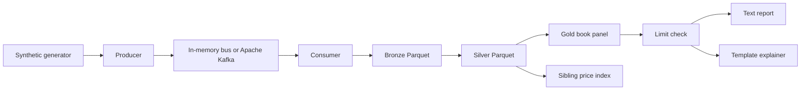

# Market risk streaming lake

A small batch pipeline for synthetic market-risk reporting. A producer writes factor, position, and P&L events to a bus. A consumer lands them in a bronze / silver / gold Parquet lake, scores book limits, and prints a short explanation of one breach.

The numbers are generated in this folder. The default run uses an in-process bus, a local directory as the lake, and a fixed text template. Apache Kafka, Azure Data Lake Storage Gen2, and an OpenAI-compatible model are optional and stay off unless you turn them on.

This is a personal interview demo. It is not a production risk system, not a limit framework, and not investment advice. It is not affiliated with any employer. Nothing here is private market data, a desk extract, or a proprietary model.

## Skills

| Skill | Where it shows up |
| --- | --- |
| Apache Kafka | Three topics, a Kafka producer/consumer, and a single-node KRaft broker in `docker-compose.yml`. Tests and the default demo use an in-memory bus with the same interface. |
| Azure Data Lake | `LakeWriter` writes an ADLS-style layout (`bronze/market-factors/date=.../`). The default writer is the local disk. `AzureDataLakeGen2Writer` is an optional extra. |
| System architecture | One batch worker, the compose file, and the diagram below. |
| Risk management | Gross notional, daily loss, and a short-window historical VaR, scored against `config/limits.yml`. Expected Shortfall is printed and is not a limit. |
| Generative AI | An `Explainer` turns one breach into plain English. The template needs no key. A model client runs only when you ask for it. |



## Quick start

```bash
cd market-risk-streaming-lake
python -m venv .venv
source .venv/bin/activate          # Windows: .venv\Scripts\activate
python -m pip install -e ".[dev]"

risk-lake demo                     # or: python -m risk_lake
python -m pytest
```

Python 3.10 or newer. The default command needs no Docker, no cloud account, no network, and no API key. It rewrites `lake/bronze`, `lake/silver`, and `lake/gold`. That directory is gitignored.

GitHub Actions runs the same tests from [`.github/workflows/market-risk-streaming-lake.yml`](../.github/workflows/market-risk-streaming-lake.yml) on Python 3.12. The workflow is path-filtered to this folder and that workflow file.

## What the demo writes

Seed 7 builds 60 weekday sessions, Monday 5 January 2026 through Friday 27 March 2026. There is no holiday calendar. Each instrument is a zero-drift geometric random walk. The timestamp on every event is `21:00:00Z`, a placeholder close rather than an exchange time.

The last session is then overwritten:

| Instrument | Last change | Last quantity |
| --- | --- | --- |
| SYN-EQ-1 | -8% | 45,000 (20,000 on earlier sessions) |
| SYN-EQ-2 | -1% | 10,000 |
| SYN-FI-1, SYN-FI-2, SYN-FX-1 | 0 | unchanged |

P&L on a session is `quantity * (close - previous close)`, rounded to cents, and the last session uses the new SYN-EQ-1 quantity. A production P&L explain would split the size change from the market move. Factor levels are rounded to 6 decimal places. The stored `change` is the draw, after rounding to 8 decimal places.

| Instrument | Class | Start level | Daily vol | Desk | Book | Base quantity |
| --- | --- | --- | --- | --- | --- | --- |
| SYN-EQ-1 | equity | 100 | 1.2% | EQ-DELTA-1 | EQ-DELTA-1-BOOK-A | 20,000 |
| SYN-EQ-2 | equity | 80 | 1.5% | EQ-DELTA-1 | EQ-DELTA-1-BOOK-A | 10,000 |
| SYN-FI-1 | rates | 102 | 0.3% | FI-RATES-1 | FI-RATES-1-BOOK-A | 50,000 |
| SYN-FI-2 | rates | 99 | 0.35% | FI-RATES-1 | FI-RATES-1-BOOK-A | 40,000 |
| SYN-FX-1 | fx | 1.25 | 0.5% | FX-SPOT-1 | FX-SPOT-1-BOOK-A | 1,500,000 |

"Rates" and "fx" are labels. Every instrument is a positive price, and P&L is quantity times the price change, in USD. There is no curve, duration, or currency-pair convention.

On 26 March 2026 the equity book's gross notional is 2,464,449.86 and its P&L is a gain of 39,906.99, inside the limits below. The report scores 27 March 2026 only. That is the session the scripted shock and the larger quantity land on.

## Events and the bus

Three payloads, one topic each:

| Event | Topic | What it carries |
| --- | --- | --- |
| Market factor | `risk.market-factors` | Level and session change for SYN-EQ-1 and the other factors |
| Position | `risk.positions` | Desk, book, quantity, price, absolute notional |
| P&L | `risk.pnl` | Signed P&L for that instrument. A gain is positive |

`InMemoryBus` keeps one list per topic and returns a copy. `risk-lake demo` and `pytest` use it. It does not exercise retention, consumer groups, or delivery.

`KafkaBus` is the same `publish` / `consume` interface against Apache Kafka. The client library is optional:

```bash
python -m pip install -e ".[kafka]"
```

The demo consumer uses a new group id, `auto_offset_reset=earliest`, and stops once the log is idle. That reads the batch this process just wrote. A long-running service would keep a stable group id instead.

## Kafka

`docker-compose.yml` starts Apache Kafka 3.9.1 in KRaft mode: one combined broker and controller, plaintext, replication factor 1. `localhost:9092` is the listener for a client on the host. `broker:19092` is the listener for another container. This is a local demo broker, not a shared cluster.

Broker only, then the demo from the virtualenv:

```bash
docker compose up -d broker
risk-lake demo --bus kafka --bootstrap-servers localhost:9092
docker compose down
```

Or build the one-shot worker as well. It runs the same demo inside the compose network and writes `./lake` on the host. The worker exits after the batch. The broker stays up until you stop it.

```bash
docker compose up --build
docker compose down
```

## Lake

`LakeWriter.write_table` places a part file at:

```text
{layer}/{dataset}/date=YYYY-MM-DD/part-000.parquet
```

`layer` is `bronze`, `silver`, or `gold`. The default implementation is `LocalLakeWriter`, which uses a directory on disk. A rerun deletes those three directories under the lake root and writes them again.

Bronze is the payload as consumed, partitioned by `session_date`. The pipeline reads that Parquet back before the next step.

Silver keeps the first valid copy of each `event_id`, rewrites the timestamp as UTC to the second, and adds:

- positions: `signed_market_value = quantity * price`, and a check that `notional` matches `abs(quantity * price)` within two cents
- P&L: `loss = -pnl`

A row that fails validation is counted. The demo stops if the count is not zero. The seeded generator produces no rejects.

Gold is the book panel and the limit snapshot:

```text
lake/
  bronze/market-factors/date=2026-01-05/part-000.parquet
  bronze/positions/date=.../
  bronze/pnl/date=.../
  silver/market-factors/date=.../
  silver/positions/date=.../
  silver/pnl/date=.../
  gold/book-daily/part-000.parquet
  gold/risk-report/date=2026-03-27/part-000.parquet
  gold/limit-breaches/date=2026-03-27/part-000.parquet
  gold/sibling-prices/prices.csv
```

### Azure Data Lake Storage Gen2

The Azure adapter uploads that same relative path to a filesystem. `risk-lake demo` never constructs it, and the tests do not import the SDK.

```bash
python -m pip install -e ".[azure]"
```

```python
from risk_lake.lake import AzureDataLakeGen2Writer

writer = AzureDataLakeGen2Writer.from_env()
```

Environment variables, and no credentials belong in the repo:

- `AZURE_STORAGE_FILESYSTEM` — the filesystem name
- `AZURE_STORAGE_CONNECTION_STRING`, or both `AZURE_STORAGE_ACCOUNT` and `AZURE_STORAGE_ACCOUNT_KEY`

The demo reads bronze back from disk in order to build silver. The Azure class implements the write side of `LakeWriter`. Pointing this demo at a real account is a separate deployment step and is not required to run or test it.

## Limits

`config/limits.yml` holds one gross-notional limit, one daily-loss limit, and one historical-VaR limit per book. Amounts are USD. A metric breaches when its value is strictly greater than its limit. Utilization is value divided by limit.

| Book | Notional | Daily loss | Historical VaR |
| --- | ---: | ---: | ---: |
| EQ-DELTA-1-BOOK-A | 4,000,000 | 200,000 | 80,000 |
| FI-RATES-1-BOOK-A | 12,000,000 | 80,000 | 60,000 |
| FX-SPOT-1-BOOK-A | 3,000,000 | 40,000 | 25,000 |

Daily loss is `max(-P&L, 0)`. A gain cannot breach it. Gross notional is the sum of absolute instrument notionals on the latest session. Historical VaR and Expected Shortfall use the last 40 book-level daily P&L amounts, equal weight.

P&L is signed, gain positive. Both risk figures are loss amounts:

```text
VaR(c) = -quantile(P&L, 1 - c)
```

The quantile is Hyndman-Fan type 7, NumPy's linear method. Expected Shortfall is Acerbi's tail average on the same sample. With ordered P&L `R(1) <= ... <= R(n)`, `alpha = 1 - c`, `u = n * alpha`, and `k = floor(u)`:

```text
ES(c) = -1/u * (sum of R(1)..R(k) + (u - k) * R(k+1))
```

When `u` is an integer, ES is the average of the worst `u` P&L amounts, written as a loss. These are the same two estimators the sibling project uses on returns. They are reimplemented here. This package does not import that one.

At 95% and 40 observations, `u = 2`. ES is the average of the two worst days. The type 7 quantile sits between the second-worst and the third-worst day, so the single scripted loss moves ES and does not set VaR. On this run those equity-book amounts are -318,412.15, -53,996.40, and -45,938.07. ES prints 186,204.27. VaR prints 46,340.99. About two tail points is a coarse quantile, and the report says so.

ES is stored on the gold row and is not compared with a limit. Equity ES is above the VaR limit. That is not a breach.

The snapshot does not walk earlier sessions for past breaches. 26 March is inside the equity limits. 27 March is the day that fails notional and daily loss. VaR on all three books stays inside the configured limits.

## Sample report

This is the default `risk-lake demo` output for seed 7.

```text
market-risk-streaming-lake 0.1.0
Synthetic streaming ingest, medallion lake, and book limit monitor

Sessions: 2026-01-05 to 2026-03-27 (60 weekdays)
Events: 300 market factors, 300 positions, 300 pnl
Bus: memory
Topics: risk.market-factors, risk.positions, risk.pnl
Lake: lake
Sibling price index: lake/gold/sibling-prices/prices.csv
Limits scored on 2026-03-27. Historical VaR and ES use the last 40 daily P&L amounts at 95.00% confidence, equal weight, Hyndman-Fan type 7.
P&L is signed, gain positive. VaR, ES, and daily loss are loss amounts.
A breach is value > limit. ES is shown and is not a configured limit.
Explainer: template.

Desk         Book                       Notional    Util     Daily loss    Util         VaR 95    Util          ES 95 Status
EQ-DELTA-1   EQ-DELTA-1-BOOK-A      4,306,093.91  107.7%     318,412.15  159.2%      46,340.99   57.9%     186,204.27 breach
FI-RATES-1   FI-RATES-1-BOOK-A      8,811,497.39   73.4%           0.00    0.0%      32,045.25   53.4%      38,378.44 inside
FX-SPOT-1    FX-SPOT-1-BOOK-A       1,836,979.50   61.2%           0.00    0.0%      12,218.25   48.9%      20,235.00 inside

The VaR window has 40 observations and about 2.0 expected tail points at this confidence, so the historical quantile is coarse.

Breaches: 2
- EQ-DELTA-1 / EQ-DELTA-1-BOOK-A daily loss: 318,412.15 against 200,000.00 (159.2% of limit)
- EQ-DELTA-1 / EQ-DELTA-1-BOOK-A gross notional: 4,306,093.91 against 4,000,000.00 (107.7% of limit)

Sample explanation (template, not a model decision):
EQ-DELTA-1 / EQ-DELTA-1-BOOK-A is over its daily loss limit on 2026-03-27. The figure is 318,412.15 USD and the limit is 200,000.00 USD, which is 159.2% of the limit. The template only restates those inputs. It does not give a cause. A person reviews this breach before any action. This text is not the decision.

Personal interview demo. Not a production risk system. Not investment advice. Not affiliated with any employer.
```

The sample sentence is the breach with the higher utilization. It is filled from the desk, book, metric, value, limit, and utilization. It does not add a cause.

## Explanation layer and AI risk

Breach flags are computed in `limits.py` before any sentence is built. The explainer cannot clear or raise a breach.

`TemplateExplainer` is the default. It is deterministic, it runs offline, and the tests check its wording. `risk-lake demo` keeps this path even when `OPENAI_API_KEY` is present.

The optional client is selected only with `--explainer openai`. It then requires `OPENAI_API_KEY`. `OPENAI_BASE_URL` defaults to `https://api.openai.com/v1`, and `OPENAI_MODEL` defaults to `gpt-4o-mini`. The request body is a chat-completions call. The user message is JSON with eight fields: session date, desk, book, metric, value, limit, utilization, and currency. The lake is not attached. If the call fails, the demo exits with an error rather than pretending the template was the model.

A short note in the spirit of the NIST AI Risk Management Framework:

- Govern. The template is the default. An external model runs only after a person sets `--explainer openai` and supplies a key.
- Map. The model sees those eight synthetic fields. The demo has no customer, employee, or employer data to send.
- Measure. The template is covered by tests. The model path is not scored here. A language model can state a cause that is not in the figures.
- Manage. A person reads the sentence. The breach table is the record. The sentence is not an automatic limit action.

## Relation to market-risk-var-es

[`market-risk-var-es`](../market-risk-var-es/) estimates one-day VaR and Expected Shortfall from a price file, then backtests the VaR. This project does not import it and does not need it installed.

Gold writes `lake/gold/sibling-prices/prices.csv`, a positive price index of each book's simple P&L return. The columns are `SYN-EQ`, `SYN-FI`, and `SYN-FX`, one per book. The index starts at 100 on the first session. From the next session:

```text
r(t) = pnl(t) / notional(t-1)
P(t) = P(t-1) * (1 + r(t))
```

`P(t)` is rounded to 6 decimal places. The first session's P&L is the base and is not a return. On the shock day, `r(t)` uses the new quantity, so it is the book P&L return rather than the factor return alone.

The sibling engine can read that file. Its default window of 250 does not fit 59 returns. Use a shorter window:

```bash
cd ../market-risk-var-es
python -m market_risk \
  --prices ../market-risk-streaming-lake/lake/gold/sibling-prices/prices.csv \
  --weights SYN-EQ=0.50,SYN-FI=0.30,SYN-FX=0.20 \
  --window 20
```

The weights are an illustrative mix for that command, not a recommendation. The index is a rebuilt P&L path, not a market price. Rounding means a return recomputed by the sibling project is a close reconstruction of `pnl / prior notional`. Running that command is optional. The tests in this folder do not install the other project.

## From code

```python
from risk_lake.pipeline import DemoRequest, run_demo

result = run_demo(DemoRequest(sessions=60, seed=7))
print(result.snapshot.as_of, result.snapshot.breaches[0].metric_label)
```

Other entry points:

```bash
risk-lake demo --sessions 60 --seed 7 --lake lake --limits config/limits.yml
risk-lake demo --bus kafka --bootstrap-servers localhost:9092
risk-lake demo --explainer openai    # only if OPENAI_API_KEY is set
```

## Layout

```text
market-risk-streaming-lake/
  pyproject.toml
  docker-compose.yml
  Dockerfile
  config/limits.yml
  src/risk_lake/
    events.py         factor, position, and P&L schemas
    synthetic.py      seeded generator and the last-session overlay
    bus.py            in-memory bus and optional Kafka bus
    streaming.py      producer and consumer
    lake.py           LakeWriter, local files, optional ADLS Gen2
    transform.py      bronze to silver
    measures.py       historical VaR and ES on book P&L
    limits.py         YAML limits and the snapshot
    explain.py        template, and the optional model client
    pipeline.py       one batch
    report.py         text report
    cli.py            risk-lake demo
  tests/
```

## Limitations

The generator is a seeded random walk plus one scripted session. It is not a market, a factor model, or a historical scenario library.

P&L is linear in price. There is no full revaluation, no options, no financing, no liquidity horizon, and no FX conversion. The rates and FX labels do not bring a curve or a quote convention with them.

The latest session applies the new equity quantity to that session's price change. Intraday timing is not represented.

Limits are three book-level numbers on the latest session. There is no hierarchy, no intraday limit, no limit server, and no scan of earlier days. A book that is missing from the YAML, or an extra book in the data, stops the demo instead of being skipped.

Historical VaR and ES weight each day in the window equally. There is no GARCH filter, no exponentially weighted covariance, and no volatility scaling. Forty days at 95% is about two expected tail points. The scripted loss sits in ES and outside the VaR quantile. A negative VaR would mean the threshold outcome is a gain, and it would not breach a positive limit.

The in-memory bus is the path the tests run. It does not show Kafka retention, rebalancing, or at-least-once delivery. The compose file is one plaintext broker.

The Azure writer is the same relative layout behind an optional SDK. The default demo and CI do not open a cloud connection, and this repo does not ship a read path for ADLS.

The template restates the breach fields. The optional model can invent a story around them. Neither one is the control that decides the breach. A person reviews the sentence. The default demo does not send data to a model.

The sibling price index drops the first session's P&L and rounds each level to 6 decimal places. It is a convenience file for the other demo, not an official risk-factor history.

This is a personal interview demo. It is not investment advice, not a trading signal, and not affiliated with any employer.
